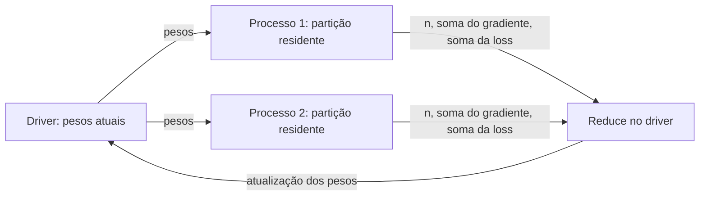
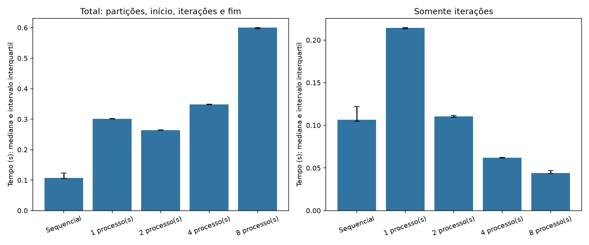
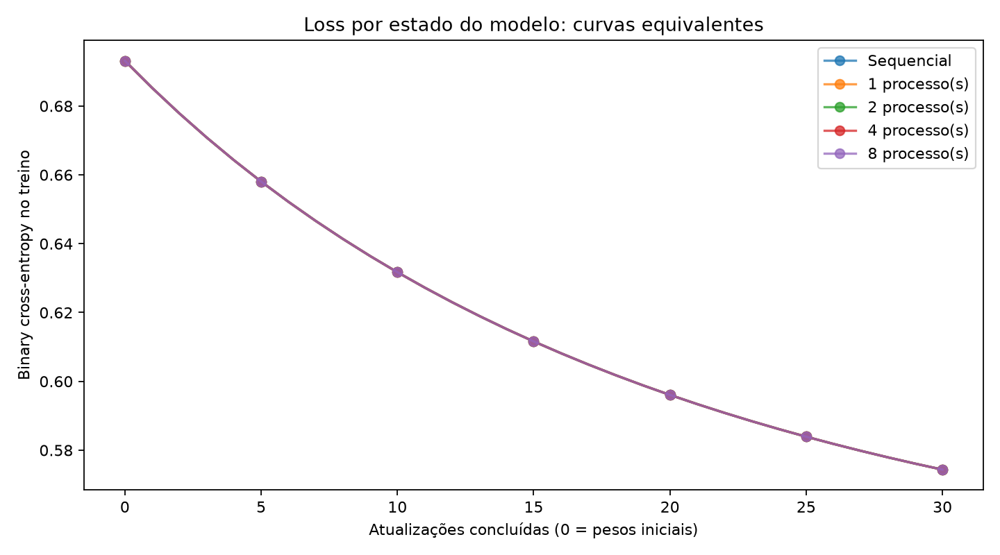

# Simulação de treinamento distribuído com conceitos do Apache Spark

Regressão logística implementada com NumPy sobre corridas reais do NYC Yellow Taxi. O driver coordena processos Python que mantêm partições em memória, calculam contribuições locais e devolvem somas de gradiente e loss. O experimento compara os mesmos cálculos em execução sequencial e paralela.

É uma **simulação de conceitos de Spark com paralelismo local real**. A proposta do trabalho é demonstrar esses conceitos em Python; este projeto não depende de PySpark nem implementa um cluster.

## Instalação e dados

Ambiente validado: **Python 3.12.3**. As versões das dependências estão fixadas em `requirements.txt`.

```bash
python3.12 -m venv .venv
source .venv/bin/activate  # Windows: .venv\Scripts\activate
python -m pip install -r requirements.txt
```

Use o arquivo `yellow_tripdata_2025-01.parquet`, publicado na seção January 2025 do [portal oficial NYC TLC](https://www.nyc.gov/site/tlc/about/tlc-trip-record-data.page). O dataset não é versionado. No fluxo deste projeto, ele permanece na máquina 5090; código, logs pequenos e gráficos podem ser trazidos ao Mac. O treinamento utiliza **CPU**, mesmo nessa máquina; não há CUDA.

Execute os comandos abaixo na máquina que armazena o arquivo. O parâmetro `--data` aceita outro caminho e evita duplicar o dataset.

```bash
python train.py --data data/yellow_tripdata_2025-01.parquet
```

## Problema e preparação

O alvo indica **gorjeta registrada de pelo menos 20% da tarifa do taxímetro**, ao final da corrida. `fare_amount` não é o valor total com taxas. As entradas são distância em milhas, tarifa, passageiros, duração em minutos e hora de pickup. Duração e tarifa são conhecidas ao fim da corrida; o cenário de previsão é esse momento, antes da gorjeta.

- Apenas pagamentos por cartão (`payment_type=1`). A TLC informa que gorjetas em dinheiro não entram em `tip_amount`; uma gorjeta adicional em dinheiro também não é observada em uma viagem paga com cartão. Consulte o [dicionário oficial](https://www.nyc.gov/assets/tlc/downloads/pdf/data_dictionary_trip_records_yellow.pdf).
- Pickup no mês solicitado por `--month` (padrão `2025-01`). O dropoff pode ocorrer no mês seguinte.
- Timestamps válidos e números finitos; distância de 0,1 a 100 milhas, tarifa de 1 a 500 dólares, 1 a 6 passageiros, duração de 1 a 240 minutos e gorjeta não negativa.
- Valores monetários convertidos em centavos inteiros com arredondamento para o par (`np.rint`); o limite é `5 * tip_cents >= fare_cents`. Isso classifica corretamente US$ 3,40 sobre US$ 17,00, que a divisão em ponto flutuante pode colocar abaixo de 20%.
- Amostra sem reposição, split estratificado 80/20 e seed 42. O scaler é ajustado exclusivamente no treino. `tip_amount` e `total_amount` não entram nas features.

Os limites de limpeza definem a população estudada e podem excluir corridas legítimas extremas. O split aleatório compara exemplos do mesmo mês; não demonstra generalização para meses futuros. Cada linha descartada é contada uma única vez, pelo primeiro filtro que reprova o registro.

## Execução e demonstração

A configuração padrão utiliza 300 mil corridas válidas, 30 atualizações, taxa 0,1 e cinco repetições de cada modalidade: sequencial e processos com 1, 2, 4 e 8 workers.

```bash
# Mostrar partições, PIDs e agregação antes do benchmark.
python train.py --data data/yellow_tripdata_2025-01.parquet --demo

# Experimento menor, mantendo repetições e um controle com um worker.
python train.py --sample-size 100000 --workers 1 2 4 --repeats 5

# Outro tamanho com registros reais, sem duplicação.
python train.py --sample-size 1000000 --output-dir outputs/1m
```

`--sample-size 0` usa todas as linhas válidas disponíveis; outros valores positivos limitam a amostra. `--epochs`, `--learning-rate`, `--test-size`, `--seed`, `--month` e `--output-dir` são configuráveis. Frações inválidas, números não finitos, workers duplicados e amostras sem condições para estratificação são rejeitados com mensagens claras.

O método de inicialização padrão é `spawn`, disponível em Linux, macOS e Windows. `--start-method forkserver` é uma alternativa onde estiver disponível. Os testes e a execução versionada usam `spawn`; a suíte também verifica `forkserver` quando disponível. O programa limita BLAS/OpenMP a uma thread por processo e registra os pools detectados.

O modo `--demo` faz uma atualização separada, com até quatro processos, e imprime algo como:

```text
DRIVER pid=... | dados enviados uma vez; workers prontos
MAP partição=0 pid=... linhas=60000 norma_gradiente_soma=...
MAP partição=1 pid=... linhas=60000 norma_gradiente_soma=...
MAP partição=2 pid=... linhas=60000 norma_gradiente_soma=...
MAP partição=3 pid=... linhas=60000 norma_gradiente_soma=...
REDUCE driver=... linhas=240000 norma_gradiente_médio=...
```

Os logs da demonstração ficam fora das medições.

## Arquitetura e relação com Spark



1. **Driver:** mantém os pesos e coordena as épocas.
2. **Partições:** fatias contíguas, disjuntas e completas do treino. Nesta simplificação, há uma partição fixa por processo.
3. **Workers e persistência:** cada `multiprocessing.Process` recebe seus arrays na inicialização e os reutiliza até encerrar. Os dados não são reenviados em cada época.
4. **Broadcast simulado:** o driver envia os mesmos pesos aos processos por `Pipe`. Cada avaliação de uma partição é uma tarefa; um processo executa várias tarefas ao longo do treinamento.
5. **Map:** cada processo retorna `(n_i, soma_gradiente_i, soma_loss_i)`.
6. **Reduce e sincronização:** o driver espera todas as contribuições, soma os gradientes e divide por `N = soma(n_i)`. Atualiza `w = w - learning_rate * gradiente_global` uma vez por época. Partições menores têm o peso correto.

A regressão logística é manual: batch gradient descent, sem regularização ou mudança de otimizador. Sequencial e paralelo compartilham a mesma fórmula. A loss usa logits com `np.logaddexp`, e a sigmoid evita overflow. O histórico tem **epochs + 1 valores**: época 0 representa os pesos iniciais; época 30 representa os pesos após 30 atualizações. O último ponto corresponde ao modelo avaliado no teste.

Spark distingue partições, tarefas, executores e máquinas; esta simulação agrupa alguns desses papéis. A persistência local ilustra a reutilização de dados em memória; a soma no driver ilustra a agregação, sem implementar um shuffle distribuído. Avaliação preguiçosa, lineage, recuperação de falhas, rede e armazenamento distribuído ficam fora da implementação. Referência: [guia oficial de RDDs, persistência e broadcast](https://spark.apache.org/docs/latest/rdd-programming-guide.html).

O driver ainda carrega e prepara todo o arquivo com pandas antes de amostrar. Portanto, esta implementação precisa de memória suficiente para essa etapa. Um sistema Spark real pode distribuir leitura e processamento entre máquinas.

## Medições e saídas

A ordem das configurações é embaralhada em cada repetição com seed registrada. Uma referência sequencial é calculada fora das medições; **pesos e histórico de todas as execuções** precisam coincidir com ela dentro de tolerância numérica antes de salvar os resultados.

O gráfico de tempo apresenta duas medidas, com mediana e intervalo interquartil:

- **Total:** particionamento, criação dos processos, envio inicial dos dados, iterações, encerramento e limpeza. Na versão sequencial, inclui o controle de threads e o cálculo.
- **Somente iterações:** 30 atualizações e 31 avaliações do estado de treino, com a comunicação e agregação necessárias. Exclui criar e encerrar processos.

Leitura, pré-processamento, hash do arquivo, validação de entrada, demonstração, referência de equivalência e avaliação no teste ficam fora desses tempos. As fases são registradas por execução; a mediana da soma não precisa coincidir com a soma das medianas.

O speedup total é `mediana_sequencial / mediana_da_configuração`. O JSON também informa o speedup das iterações. O caso com um worker mede o custo da infraestrutura de processos. As barras de erro descrevem a dispersão observada, não um intervalo de confiança.

Saídas em `outputs/`:

- `tempo_por_workers.png`: tempo total e das iterações.
- `loss_por_epoca.png`: estados do modelo, incluindo pesos iniciais e finais.
- `resultados.json` (schema 2): repetições individuais, ordem, tempos, métricas, matriz de confusão, baseline, pesos, features, scaler, contagem dos filtros, distribuição das classes, seed, parâmetros, SHA-256 do dataset e do código, versões, CPU e threads.

## Resultado real versionado

Arquivo oficial de janeiro de 2025: 3.475.226 linhas, 2.444.393 com cartão e **2.399.018 válidas**. O filtro mensal excluiu 16 pickups fora de janeiro. Amostra de 300.000, treino de 240.000 e teste de 60.000, com 30 atualizações, taxa 0,1, cinco repetições e `spawn`. Máquina com Intel Core Ultra 9 285K e uma thread por processo; a RTX 5090 não participa do cálculo.

<!-- BENCHMARK_TABLE_START -->
| Modalidade | Total mediano | Iterações medianas | Speedup total | Speedup das iterações |
|---|---:|---:|---:|---:|
| Sequencial | 0.107 s | 0.106 s | 1.00× | 1.00× |
| 1 processo(s) | 0.301 s | 0.214 s | 0.36× | 0.50× |
| 2 processo(s) | 0.264 s | 0.111 s | 0.40× | 0.96× |
| 4 processo(s) | 0.349 s | 0.062 s | 0.31× | 1.71× |
| 8 processo(s) | 0.600 s | 0.044 s | 0.18× | 2.41× |
<!-- BENCHMARK_TABLE_END -->

As iterações se beneficiam da divisão dos dados, mas o custo de iniciar processos supera esse ganho no tempo total desta amostra. O speedup é uma propriedade da carga, da implementação e da máquina; aumentar workers não garante reduzir o tempo total.

Todos os modelos produziram acurácia **0,7591**, F1 **0,8604**, acurácia balanceada **0,5208** e ROC-AUC **0,5993**. A baseline, que escolhe a classe majoritária usando o treino, alcançou acurácia **0,7647**, F1 **0,8666** e acurácia balanceada **0,5000**. A matriz de confusão do modelo é `[[999, 13121], [1334, 44546]]`: linhas são classes reais 0/1 e colunas são previsões 0/1.

A loss de treino caiu de **0,693147** para **0,574359**. A redução não comprova que a otimização terminou. O objetivo é demonstrar equivalência e custos do processamento, e as métricas não mostram vantagem preditiva sobre a baseline majoritária em acurácia ou F1. Os valores diferem dos resultados anteriores porque foram corrigidos os rótulos e o período de pickup, alterando também a população da amostragem.





## Validação

```bash
python -m unittest -v test_training
```

Os testes verificam o limite monetário, dados inválidos, contagem dos filtros, mês de pickup, split e scaler; gradiente por diferenças finitas e loss em logits extremos; cobertura das partições; pesos e histórico finais; processos com PIDs distintos, agregação de partições desiguais, controle com um worker e limpeza após falhas/timeout. As pequenas fixtures de teste não são usadas para gerar os resultados do trabalho.

## Roteiro de apresentação

1. Apresentar o problema: dividir o trabalho de um treinamento iterativo sobre registros reais de mobilidade.
2. Explicar Spark como mecanismo para processamento paralelo em um cluster e identificar os conceitos simulados.
3. Mostrar `--demo`: driver, PIDs diferentes, partições, envio dos pesos e agregação ponderada. Destacar a reutilização das partições.
4. Mostrar as curvas de loss sobrepostas como evidência de equivalência numérica, incluindo o estado final.
5. Comparar os tempos total e das iterações e explicar por que o custo inicial pode superar o ganho do cálculo paralelo.
6. Mostrar baseline e matriz de confusão; explicar por que um F1 alto pode coexistir com classificação fraca da minoria.
7. Relacionar a abordagem a um cenário de Big Data: dados e computação distribuídos em várias máquinas. Identificar o limite atual de leitura centralizada, a comunicação local e as funcionalidades de Spark que não foram simuladas.
